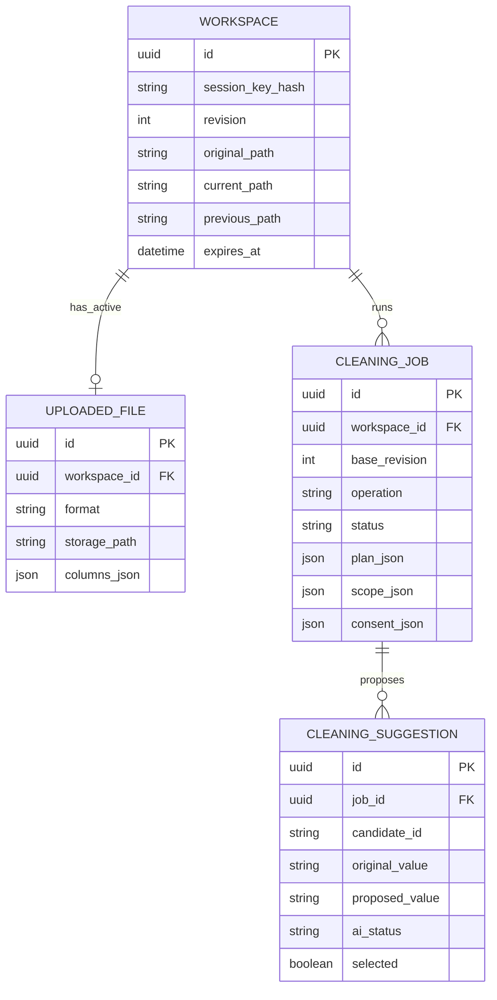

# RegexGenie V1.9 — Assignment-Focused P0 + P1 Implementation Specification

**版本**：V1.9（替代 V1.8 的第一阶段交付基线）  
**日期**：2026-11-03（Australia/Melbourne）  
**状态**：已选定的产品与开发规格，**未授权编码、改动现有仓库或部署**；须待用户明确说“开始开发”。  
**代码基线**：现有 [Silviaaq/RegexGenie](https://github.com/Silviaaq/RegexGenie) 的 V1.5 实现；开发开始时先检查真实源码、迁移及已部署功能，增量修改，不推翻可用功能。  
**文档语言**：中文；**网站 UI 和错误提示必须使用英文**；原始数据保留原语言。  
**目标**：优先完成原始 **Web Application for Regex Pattern Matching and Replacement** Assignment；增加两个受控的可选 LLM 清洗能力；交付 GitHub 源码、README、测试和公开可用的网址。

> 本文的模型、字段、URL、例子属于**待实现的契约**，不是现有代码已具备的能力。旧 V1.8 文档作为历史参考；遇到冲突，以 V1.9 为准。现有 API 如已部署，可优先提供兼容适配而不机械重命名。

---

## 1. 对 Assignment 的逐项映射

| 作业要求 | V1.9 实现/验收 | 优先级 |
|---|---|---|
| Django Project + Models/Views/URLs | 明确的 ORM 模型、Views、URLConf，迁移和 API 测试 | **P0** |
| React Frontend | 上传、表格、指令、替换值、预览和下载 UI | **P0** |
| Upload CSV / Excel | UTF-8 CSV、标准 `.xlsx`；支持选择一个 Excel Sheet | **P0** |
| Natural Language → Regex via LLM | 真实 Groq 调用，生成可执行模式，后端严格验证 | **P0** |
| **Users specify replacement value** | 用户主流程显式填写 Replacement Value；填写值为最终权威值 | **P0** |
| Replace matched text + display results | Django 确定性执行，Before/After，提供导出 | **P0** |
| Optional LLM transformation 1 | Semantic Value Normalisation | **P1** |
| Optional LLM transformation 2 | Missing Value Recognition & Normalisation | **P1** |
| Error handling, maintainability, good design | 输入校验、Regex 资源保护、拆分 services、自动化测试 | **P0/P1** |
| GitHub + README + public deployment | 干净仓库、环境配置说明、公开网站端到端测试 | **交付必须** |

**P0 可独立通过的演示**：上传 `customers.csv` → 输入 `Find email addresses in the Email column` → 在 Replacement Value 输入 `REDACTED` → 真实 LLM 产生 Regex → Django 替换 Email 列中的匹配子串 → 页面展示 Before/After → 下载可验证结果。严禁以固定邮箱正则硬编码冒充 LLM。

## 2. 范围冻结：做什么、不做什么

### 2.1 P0（必须先完整交付）

1. 上传、替换和移除 CSV/XLSX；**文件上传上限 10 MB（10,485,760 bytes）**，另有限制最大解析行列及资源占用，不保证所有 10 MB 文件均可解析。
2. 简单矩形表格、单行表头自动识别；多 Sheet 文件选择一个目标 Sheet；无法可靠解析时给具体错误/建议。上传即出现可编辑指令框，不需要先做表头问卷。
3. 分页表格预览（每页 50 行）；稳定行号/列 ID；列名重复或目标不明确时询问目标列。
4. **自然语言指令 + Replacement Value** 两个清晰输入；普通替换要求用户指定替换值。
5. **Remove matched text** 明确操作选择，用于删除匹配内容；不要求背诵 `replace with empty text` 口令。
6. Groq 生成真实 Regex；仅将指令与必要列元数据发送云端，不上传实际单元格用于核心 Regex。
7. 后端严格校验并执行 Regex；安全超时/长度/内存保护；0 匹配可正常预览。
8. Original/Preview 双栏、匹配数量及跳转、高亮真实差异；Show Rule；必要时高风险提示并二次确认。
9. 下载 CSV/XLSX；不覆盖原上传文件；只导出目标数据表；尽可能保留导出表内**未修改** Excel 单元格的原始基础类型。
10. 轻量继续清洗、一次 Undo、Reset；临时工作区、安全 Session、文件校验、错误提示。

### 2.2 P1（在 P0 成功后交付）

**Feature 2 — Semantic Value Normalisation**：在一个文本列中标准化有效值。用户例如输入 `Standardise Country values to full English country names`。AI 产生唯一值映射建议，用户选择 Apply/Keep，后端只替换经批准的原始值。不能手动编辑建议目标字符串；歧义项标记 Needs Review。

**Feature 3 — Missing Value Recognition & Normalisation**：在一个文本列中识别可能表示缺失的表达，例如 `N/A`, `unknown`, `Not provided`。AI 输出 missing/valid/uncertain + 简短理由，用户逐项批准后才转为内部 null；不自动填充事实；`0`、`000`、`NA`、`-` 必须保持保守。

**两项共用**：一个输入框自动识别三种操作类型、一个现有目标列、建议列表及筛选、默认 Keep、仅普通 Proposed 支持批选、批准前不得改数据。清洗范围受去重值及字符预算限制；超限可以选择一部分不同值进行单次清洗，未选择的值原样保留。每次目标数据外发前明确授权。

### 2.3 延至 P2（不阻碍本次交付）

- `.xls` 老格式、UTF-16/GB18030 和其他非 UTF-8 CSV、复杂分隔符自动探测；对不支持格式给可操作错误。
- 合并单元格、多层表头、报告型 Excel 自动定位、跨 Sheet 公式和整本 Workbook 保真。
- 分布式/跨重启可靠队列、批次级断点续跑、无限历史、Redo、账户系统、持久化文件保存。
- 大规模负载/SLA、详尽资源报告、20 条×3 次的大规模模型测评。
- 新增派生列、情感分析、分类、图表、RAG/Agent、自动全表多步骤工作流。

**不会延后**：基本上传安全、匿名访问隔离、Regex 超时保护、隐私授权、用户明确确认、源文件不覆盖、基本 API 错误处理。

## 3. 已确认决定及 V1.9 的具体修订

| 决策 | V1.9 落地 |
|---|---|
| RG-D-001 | 标准化建议逐项 Apply/Keep；无任意映射编辑器 |
| RG-D-002 | 未改动 Excel 单元格尽可能保留 `str/number/date/bool/blank`，通过文件解析/导出而非通用 TypedCell 平台 |
| RG-D-003 | 全部映射建议默认 Keep，用户主动选择 |
| RG-D-004 | 同一目标列的同一原始值只能映射到一个目标值；歧义标 Needs Review，不能保证找出所有歧义 |
| RG-D-005 | Select All Proposed 排除 Needs Review；批选明确是否涵盖全部分页，建议默认涵盖整个当前任务已加载的有效建议集合 |
| RG-D-006 | 超出 LLM 范围时支持分页搜索和手动挑选不同值；不会偷偷选择任意 200 个，也不会假称完成整列 |
| RG-D-007 | 当前临时工作区复用已批准映射作为本地一致性参考；Undo/Reset 后失效，不永久保存 |
| RG-D-008 | 导出是 **Cleaned Data Export**，仅一个目标表；提前告知不保留其他 Sheet、版式和公式 |
| RG-D-009 | Regex 高影响变更须额外确认；硬性不安全模式必须拒绝 |
| 技术 Q1–Q9 | 复用 V1.5；匿名 Session；临时文件；普通表格；唯一列推断/歧义询问；轻量异步队列；多信号风险；Groq；Docker/Render 免费实例（需验证） |
| **V1.9 关键变更** | **普通 Regex 的 Replacement Value 由用户显式输入；空值不偷偷代表删除，删除由显式 Remove 操作触发。** 若只在指令中写了替换词，可由 LLM 识别并**预填待用户确认**，不能静默 Apply。 |

## 4. 核心交互与字段语义

### 4.1 上传到下载的统一流程

`Upload → Table Preview → Instruction + (Regex Replacement / Remove) → Generate → Review Preview or AI Suggestions → Confirm/Apply → Download`。

- 上传文件后直接展示 Instruction 输入框，不要求用户先选功能模式。
- 识别目标列：列名或上下文能唯一确定才自动选中；若多个候选则要求用户明确选择一个列；不扫描整张表的所有文本列做改写。
- Backend 根据 instruction 判定 `regex_replace | normalise_values | normalise_missing`。如果一个指令混合多种操作，要求用户分开提交。
- 首次进入页面无法预知意图，所以主表单始终展示 Replacement Value；一旦确定为 P1，结果视图隐藏/禁用该字段并说明该操作使用 AI 建议而非字面替换。P1 绝不消费已填写的替换字段。

### 4.2 Replacement Value：Assignment-first 契约

1. **普通替换（默认）**：主表单同时展示 `Instruction` 与 `Replacement Value`。当任务被判定为 Regex 时，两者均为必填（除非用户明确选 Remove）。允许任意非空字符串，包含空格；**后端保留用户原样输入**，不能做 `.strip()` 后改变要写入的数据。前端只用首尾空白做“是否输入了值”判定时需提示确认特殊空白值，而非悄悄裁剪。
2. **删除匹配文本**：用户明确选 `Remove matched text`（例如清晰的切换控件）；此时后端令 `replacement=""`，独立于 Optional 字段与 LLM 的推断。若用户切换回 Replace，须填写明确值。
3. **指令自带替换目标**：例如 `replace emails with REDACTED`，若字段仍为空，LLM 可以提出建议并把 `REDACTED` 显示为建议/预填，但必须由用户确认字段；**不能默默执行模型决定的值**。
4. **冲突优先级**：明确填写的 Replacement Value / 明确 Remove 操作 > 指令中描述的候选替换内容 > 任何 LLM 猜测。
5. 数据模型以 `action=replace|remove` 和 `replacement_value` 表达，不再采用 V1.8 的 null/非空/口令三态方案。用户只有在 Regex 子流程满足字段要求后才能确认应用。

示例 UI 文案：`Describe what to find` / `Replacement value` / `Remove matched text` / `Generate preview`。不把删除语义藏在 placeholder。

### 4.3 审阅与一致性

- Regex 必须实际计算匹配位置；页面显示匹配数、修改行数以及 BEFORE/AFTER。**预览不是已提交版本**。
- 标准化与缺失值建议默认 Keep。若用户选择零条，则显示 `No changes selected`，不创建版本。
- 高歧义 `Needs Review` 必须单独点击 Apply，不参与 `Select All Proposed`。
- 继续清洗当前结果时，工作区内保留已接受的映射；但不自动修改此前已接受的结果。
- `Download` 在 Regex 中可以先执行明确的 Apply 再下载固定版本；高风险时须先完成二次确认。

## 5. 技术栈与简化架构

| Layer | 选型 | 原则 |
|---|---|---|
| Frontend | 复用现有 React + Vite + CSS | 先审计实际 package.json，不为美化而重构 |
| Backend | Django 原生 JSON Views + URLConf（复用现有方案） | 满足作业 Models/Views/URLs；无必要不强制加 DRF |
| Data processing | Python `csv` 标准库、`openpyxl`、受限 `regex` 执行 | CSV 保留原始文本/前导零，XLSX 保留基本单元格类型 |
| LLM | Groq API via `LLMService` | 配置模型名，严格 JSON 解析，模型只提议，Python 执行 |
| Persistence | Django SQLite + 临时私有文件 | ORM 管理任务元数据；不建单元格数据库 |
| Async | 单容器轻量 worker + SQLite Job 状态轮询 | 延续用户选定的异步模式，但无独立 JobBatch/Celery/Redis |
| Deployment | Docker + Render 免费单 Web Service（待可行性实测） | 会休眠/重启，临时数据不持久，必须显式告知 |

**文件存储设计**：原始文件始终保持不变；生成一个**当前清洗结果快照**和一个**上一步快照**。只存处理所需的文件/数据，不保存无限历史。对上传 XLSX，使用打开工作簿后的原生值进行单表导出，保留未改动基本数值/日期/布尔类型；不保证样式、公式计算或 display format。CSV 使用字符串值，缺失值语义由显式操作引入。

**扩展限制（初始开发保护值，需实测）**：输入单文件≤10MB；简单表格不超过 10,000 数据行、50 列、250,000 单元格（任一超限拒绝并明确说明，允许未来调大）；单页 50 行；单任务一个列、一个操作。不能仅因文件小于10MB就跳过解压与资源保护。Excel zip decompression 设明确上限并验证。

## 6. Django Models（4 个领域模型）

依赖 Django 内置 Session 表。下表为实现目标，开发前应与现有迁移比对：尽可能复用/迁移旧 `Dataset`、`Transformation`，不能在数据库中重复保存整张表。

### 6.1 Workspace

| 字段 | 建议类型 | 说明 |
|---|---|---|
| `id` | UUIDField PK | 工作区 ID |
| `session_key_hash` | CharField(64) | 与匿名 Session 绑定；服务端检查所有权 |
| `status` | CharField(choices) | `empty/ready/expired` |
| `original_path` | CharField(nullable) | 只读的已解析原始表快照 |
| `current_path` | CharField(nullable) | 当前成功清洗结果 |
| `previous_path` | CharField(nullable) | 最近一次修改的输入快照，用于一次 Undo |
| `revision` | PositiveIntegerField | 每次成功修改/Undo/Reset 递增 |
| `last_applied_job_id` | UUIDField(nullable) | 单级撤销的来源任务 |
| `created_at`, `expires_at` | DateTimeField | 目标约30分钟清理，非可靠存续承诺 |

对 current/previous 使用**不变文件快照引用**，文件创建成功后才更新路径；对 `revision` 做条件更新保障旧任务不能覆盖新数据。Workspace 删除后安全清理关联临时文件。

### 6.2 UploadedFile

| 字段 | 类型 | 说明 |
|---|---|---|
| `id` / `workspace` | UUID PK / FK | 一个 Workspace 同时只存在一个有效源文件 |
| `original_name` | Char(255) | 仅显示，服务器使用随机私有文件名 |
| `format` | Enum(`csv`, `xlsx`) | 不靠扩展名判定真实格式 |
| `storage_path` / `sha256` | Char | 源文件引用与完整性 |
| `sheet_name` | Char nullable | 当前选择的 XLSX Sheet |
| `columns_json` | JSON | 稳定列 ID、显示列名、原生基本类型信息 |
| `row_count` / `column_count` | Integer | 分页和资源限制 |
| `created_at` | DateTime | 上传时间 |

上传失败不可覆盖之前可用的工作区。多 Sheet 选择只能针对解析出的有效表；复杂工作簿给出明确不支持说明。

### 6.3 CleaningJob

| 字段 | 类型 | 说明 |
|---|---|---|
| `id` / `workspace` | UUID PK / FK | 异步清洗任务及归属 |
| `base_revision` | Integer | 创建任务时的 Workspace revision |
| `instruction` | Text | 用户自然语言，限制长度 |
| `operation` | Enum nullable | `regex_replace/normalise_values/normalise_missing` |
| `target_column_id` | Char nullable | 绑定现有列 |
| `action` / `replacement_value` | Enum(`replace`,`remove`) / Text nullable | **仅 Regex**；替换时用户显式值，删除时空串 |
| `status` | Enum | `queued/running/needs_input/awaiting_consent/ready/failed/applied/undone/cancelled` |
| `plan_json` / `impact_json` | JSON | 已验证 Regex 或 P1 建议计划；影响统计 |
| `plan_hash` | Char(64) nullable | 防止过期计划被错误应用 |
| `scope_json` / `consent_json` | JSON | 有界已选不同值及外发授权范围，随工作区清理 |
| `risk_ack_hash` | Char(64) nullable | 高风险确认绑定 plan + version |
| `result_path` | Char(nullable) | staged 预览快照；成功 Apply 后成为当前版本 |
| `error_code`, `attempt_count` | Char / Integer | 任务错误与简单重试 |
| `created_at`, `updated_at` | DateTime | 清理与中断诊断 |

**重点**：LLM/Excel 处理耗时操作放在 DB transaction 外；任务 Apply 必须校验 `base_revision`、`plan_hash` 与已批准的建议 ID。相同 job 重复 Apply 返回既有结果或幂等拒绝，绝不重复执行。

### 6.4 CleaningSuggestion

| 字段 | 类型 | 说明 |
|---|---|---|
| `id` / `job` | UUID PK / FK | P1 建议所属任务 |
| `candidate_id` | Char | 同一 Job 唯一，不信任模型新 ID |
| `original_value` | Text nullable | 被选中的原始不同值（可能是真 null/空文本） |
| `proposed_value` | Text nullable | 标准化目标字符串；Missing 不使用此字段 |
| `ai_status` | Enum | 标准化：`proposed/needs_review/unchanged`；缺失：`missing/valid/uncertain` |
| `reason` | Text | 简短显示理由，禁执行其内容 |
| `occurrences` | Integer | 后端本地统计，不外发 LLM |
| `selected` | Boolean default false | 用户审批后最终采纳状态，初始化均为 Keep |

唯一约束 `(job, candidate_id)`；所有建议仅属于一个任务/当前工作区；API 不允许用户传入任意 proposed_value 进行写入。

### 6.5 ERD（核心领域模型）



**不另建** `DataVersion`、`ApprovedMapping`、`ConsentRecord`、`JobBatch` ORM 模型。单级 Undo 用 Workspace 快照路径，映射规则由当前工作区已应用、尚有效的 Job/Suggestion 集合推导；授权记录放在有限时长 Job JSON 中，日志不记录原始单元格。若实际源码已有对应模型，允许复用而非强删。

## 7. Django Views、URLs、API 契约（精简）

所有路径以下以 `/api/` 为前缀；建议同源部署，JSON 使用 snake_case，HTTP 变更请求带 CSRF。`workspace_id` / `job_id` 必须校验 Session 所有权；过期拒绝访问。URL 只是目标契约，不要求与现存兼容接口逐字一致。

| Method | URL | Django View | 作用 |
|---|---|---|---|
| POST | `/api/workspaces/` | WorkspaceCreateView | 创建匿名工作区；初始化 CSRF |
| POST | `/api/workspaces/{w}/upload/` | FileUploadView | multipart 上传 CSV/XLSX，校验、解析，必要时返回 Sheet 候选 |
| GET | `/api/workspaces/{w}/data/` | DataPreviewView | 原始/当前/预览数据，分页 50 行；同时返回列元数据 |
| POST | `/api/workspaces/{w}/jobs/` | CleaningJobView | 提交 instruction + Regex replacement/action，异步生成方案 |
| GET | `/api/jobs/{j}/` | CleaningJobStatusView | 轮询状态、规则、风险、影响统计和建议摘要 |
| POST | `/api/jobs/{j}/scope-consent/` | ScopeConsentView | P1 选择不同值及明确同意外发；必要时触发生成建议 |
| GET | `/api/jobs/{j}/suggestions/` | SuggestionsView | P1 查看建议列表及本地分页/过滤；超限不同值列表由 scope 阶段返回或复用 GET data 扩展 |
| POST | `/api/jobs/{j}/apply/` | ApplyCleaningView | 选择建议 ID、风险确认，校验 version 后原子提交 |
| POST | `/api/workspaces/{w}/action/` | WorkspaceActionView | `undo/reset/remove_file/replace_file`（replace_file 可复用 upload 流程） |
| GET | `/api/workspaces/{w}/export/?format=csv|xlsx` | ExportView | 仅导出固定的成功 current 快照 |
| GET | `/api/health/` | HealthView | 基本服务健康；不能暴露 Key |

**建议保留一个可用的独立 `GET /api/workspaces/{w}/values/?column_id=...` 端点**：仅当目标列不同值超预算时分页列出不同值/频次；否则可直接展示建议范围。这样最大 12 个路由，不需要 V1.8 约 20 个完整端点。

### 7.1 核心 JSON：Regex Job

`POST /api/workspaces/{w}/jobs/`（用户显式输入）

```json
{
  "instruction": "Find email addresses in the Email column",
  "action": "replace",
  "replacement_value": "REDACTED",
  "base_revision": 1
}
```

删除操作改为：`"action":"remove", "replacement_value": null`；服务端最终执行替换空串，但必须由 action 显式表达，而不是输入框留空导致。

成功 `202`：

```json
{
  "job_id": "JOB_UUID",
  "status": "queued",
  "status_url": "/api/jobs/JOB_UUID/"
}
```

`GET /api/jobs/{j}/` 当 Regex 预览可用：

```json
{
  "status": "ready",
  "operation": "regex_replace",
  "target_column_id": "col-email",
  "base_revision": 1,
  "plan_hash": "PLAN_SHA256_HEX",
  "regex": {
    "pattern": "[A-Za-z0-9._%+-]+@[A-Za-z0-9.-]+\\.[A-Za-z]{2,}",
    "flags": [],
    "replacement": "REDACTED"
  },
  "impact": {"matches": 3, "changed_rows": 3, "changed_cells": 3},
  "risk": {"requires_confirmation": false, "signals": []}
}
```

> `JOB_UUID`、`PLAN_SHA256_HEX` 为说明占位符，真实服务使用服务器生成的不透明 ID 和散列。模型不得覆盖 `replacement_value`。

### 7.2 P1 Scope 与 Consent

若已知列、不同值在预算内：Job 进入 `awaiting_consent`，前端明确显示拟向 Groq 发送**所选列的哪些不同值**。超预算时先调用 `GET .../values/` 让用户选择值，再提交：

`POST /api/jobs/{j}/scope-consent/`

```json
{
  "selected_value_ids": ["v1", "v2", "v3"],
  "approved": true,
  "base_revision": 1,
  "scope_hash": "SERVER_ISSUED_SCOPE_HASH"
}
```

后端根据真实选中集合重新计算 hash、预算并比对授权；不能只相信客户端给的 scope。`approved=false` 不得调用外部 LLM。**指令本身仍会作为规划所需输入发送到 Groq，UI 需说明这一点**。不同值/频次先在服务器本地计算，频次、邻列和整行不外发。

初始预算：最多 200 个非空精确不同值；每值 4,000 字符、总 40,000 字符并受 token 预算；超出时引导用户缩小选集。实际模型可一批处理少量值，但本版不单独建立 JobBatch ORM/断点恢复体系；整个 Job 完成后才发布建议，部分失败整体重试且有次数/速率限制。

### 7.3 Suggestions 与 Apply

P1 `GET /api/jobs/{j}/suggestions/?page=1`：

```json
{
  "status": "ready",
  "total": 3,
  "items": [
    {"id":"s1","original":"AU","proposed":"Australia","ai_status":"proposed","selected":false,"occurrences":42},
    {"id":"s2","original":"AUS","proposed":"Australia","ai_status":"proposed","selected":false,"occurrences":16},
    {"id":"s3","original":"WA","proposed":"Western Australia","ai_status":"needs_review","selected":false,"occurrences":8}
  ]
}
```

前端 Select All Proposed 只收集 `proposed`（非 `needs_review`）的全部可选择 ID，确认时展示所选数量及预计修改行数；用户仍须最终点击 Apply。Missing 操作返回 `ai_status=missing/valid/uncertain`、`reason`，只允许 `selected ID → true null`，不接受模型任意目标值。

`POST /api/jobs/{j}/apply/`：

```json
{
  "base_revision": 1,
  "plan_hash": "PLAN_SHA256_HEX",
  "selected_suggestion_ids": ["s1", "s2"],
  "confirm_high_risk": false
}
```

成功 `200`：

```json
{
  "status": "applied",
  "head_revision": 2,
  "changed_rows": 58,
  "download_url": "/api/workspaces/WORKSPACE_UUID/export/?format=xlsx"
}
```

Regex 传 `selected_suggestion_ids=[]`；高风险只有在 UI 展示具体信号后、当前计划 hash/revision 仍相同时 `confirm_high_risk=true` 才允许执行（确认状态须绑定该 Job 并在服务器校验）。无变更返回 `no_changes`，不推进版本。需要能区分当前成功数据与尚未应用的 staged preview。

### 7.4 标准错误 JSON

```json
{
  "error": {
    "code": "AMBIGUOUS_COLUMN",
    "message": "Which column should I clean?",
    "retryable": false,
    "details": {"choices": ["Email", "Contact"]}
  }
}
```

| HTTP | 代码举例 | 用户恢复方式 |
|---|---|---|
| 400 | `INVALID_REQUEST`, `REPLACEMENT_REQUIRED` | 提示缺失字段 |
| 403/404 | `FORBIDDEN`, `NOT_FOUND` | 拒绝跨会话读取，避免资源存在性泄露 |
| 409 | `STALE_REVISION`, `STALE_PLAN` | 重新读取工作区和预览 |
| 410 | `EXPIRED_WORKSPACE` | 提示重新上传并说明临时性 |
| 413 | `FILE_TOO_LARGE` | 显示文件大小限制 |
| 415/422 | `UNSUPPORTED_FORMAT`, `INVALID_REGEX`, `AMBIGUOUS_COLUMN`, `LIMIT_EXCEEDED` | 具体说明 |
| 429 | `LLM_RATE_LIMITED` | 限流提示与延后人工重试 |
| 500/503 | `INTERNAL_ERROR`, `LLM_UNAVAILABLE` | 保留既有成功结果，显示可重试提示 |

## 8. LLM 输入输出与安全执行

### 8.1 单一 LLMService、三种严格任务

- `route_and_generate_regex`：输入指令 + 必要列名/ID；输出 `operation=regex_replace, target_column_id, pattern, flags`。**不要求模型决定替换值**。
- `propose_value_normalisation`：输入用户授权的目标列**精确不同值**及临时 ID，输出每个 ID 的 `proposed_value`、`status` (`proposed|needs_review|unchanged`) 与 `reason`。
- `classify_missing_markers`：输入用户授权的目标列不同值及临时 ID，输出每个 ID 的 `decision` (`missing|valid|uncertain`) 与 `reason`。

响应必须解析并严格检查 JSON/schema、类型、ID 数量/唯一性/全集、长度限制与操作白名单。缺失 ID、未知 ID、重复 ID 或不合法决策 → 整次生成失败，不给半成品可以 Apply。LLM 输出的 reason 和单元格内容均视为不可信文本，不执行指令、脚本、SQL 或 Shell。

### 8.2 Regex 验证与风险检测

安全硬限制：模式长度与 flags 白名单、可编译、禁止能匹配空字符串的危险规则、受限执行超时/最大输入长度/有界资源、不可执行模型代码。替换值始终按字面字符串解释，防止反向引用意外执行；允许常规子串替换。高成本/灾难性回溯表达式必须在受限执行器中被超时阻断，不能仅靠普通 Python `re` 在同一进程无限运行。

多信号风险（初始开发规则，非已验证性能承诺）：高修改比例、整格清空、多字符过度损失、过宽泛匹配。规则合法但信号显著时展示清晰 Before/After 样本和**二次确认**；风险高不等于错误。阈值可以通过配置/测试调整，不额外调用 LLM 审查。

### 8.3 P1 的语义安全

- 一列、一个原始不同值只映射到一个目标字符串，不能从不同上下文推断行级不同结果。
- 标准化建议默认 `selected=false`，Needs Review 只能用户逐条选中；所有已批准映射一次性确定性应用，不自动接受。
- Missing 有真实内部 null，和文字 `"null"`、空字符串不同；CSV 导出 null 表示为空字段、XLSX 表示为空单元格，**不能保证 CSV 重导后还能区分 null 与原空字符串**。必须在下载旁提示该限制。
- 同工作区再次标准化时，仅本地读取仍然生效的已应用映射记录来提示一致性；Undo 将最近成功任务标为 `undone`，Reset 将当前工作区已应用任务标为不再有效，因此无效映射不再使用。若要把历史映射作为 LLM 上下文，仍须额外明确授权，否则不外发。

## 9. 版本、任务与临时工作区

### 9.1 数据版本（只做轻量级单级 Undo）

- `Original`：初次解析的只读标准表，不修改源文件。
- `Current`：最近一次成功 Apply 后的数据文件，下载只读取这个固定成功快照。
- `Previous`：最近一次 Apply 的输入快照，用于单级 Undo；无 Redo。
- `Preview`：未提交的临时结果，在用户审阅期间不影响 Current。
- 只有有效变更才创建新 Current；0 匹配或全部 Keep 不消耗 Undo。
- 先写完整临时快照并验证，再通过 SQLite 短事务 CAS 更新 current/previous/revision；事务成功后清理多余旧快照。若文件写入/事务失败，Current 不推进；孤儿文件由 TTL 清理。
- Undo 恢复 Previous、增加 revision，并将最近 `last_applied_job_id` 任务标为 `undone`；该任务的映射不再纳入有效规则。Reset 回 Original、增加 revision，重置全部当前工作区已应用映射的有效标志。由 `status=applied` 且在当前有效操作链的 Job/Suggestion 重构映射注册表；不新建全局永久映射。重启导致快照不存在时拒绝并提示上传，不引用失效文件。

### 9.2 异步任务状态（精简，非生产级队列）

`queued → running → (needs_input | awaiting_consent | ready | failed)`，`ready → applied`，最近已应用任务可因 Undo 转为 `undone`；任意待完成任务可 `cancelled`，过期 `expired`。新任务处于 `awaiting_consent` 时，直到外发 scope 授权完成才启动会读取目标列去重值的模型调用。

- Web 请求快速返回 `202 + job_id`，React 轮询状态；同容器受管理的轻量 Worker 串行执行重任务。部署时必须验证实际是否能可靠启动 worker，并在 Render 环境测一次冷启动/重启。
- 无 `JobBatch` ORM、无无限自动重试；失败在限制内重试一次整个任务或允许用户更改指令后新建任务。
- 取消/删除/版本改变后，Worker 的迟到结果不能写入 Current；Apply 会再次检查 session owner/revision/job 状态。
- 无完整断点恢复；服务重启可将未完成任务标为 failed/interrupted，解释重试/重新上传。

### 9.3 隐私、匿名访问与生命周期

- Django Session + HttpOnly/Secure/SameSite Cookie（生产 HTTPS），所有变更接口 CSRF 校验，服务端基于 Session 校验工作区/任务/文件所有权；猜测 UUID 不能读到文件。
- 文件只存服务端私有临时目录，不使用用户文件名拼接路径；文件扩展名、MIME、真实解析均验证；限制 ZIP 解压炸弹、CSV 公式注入、恶意正则等。
- P0 仅向 Groq 发送指令及必要列元数据；P1 仅在用户选择并同意后发送选定列的去重值和临时 ID；不发送频次、邻列/整行/整文件。指令和列名自身也可能敏感，UI 应予以说明。
- 30 分钟是 TTL 清理目标，不代表可靠保存至少 30 分钟；Render 免费服务重启、休眠及部署时可能丢失会话/文件/任务；UI 显示 `Files are temporary. Download your results promptly.`
- API Key 仅保存在后端环境变量，不能提交到 GitHub、放入前端或日志；日志默认不输出行内容、真实原始值、完整 prompt 或响应。

## 10. React 组件与页面流程

建议单页三阶段，避免额外营销页。所有交互文案英文。

| 组件 | 主要职责 |
|---|---|
| `FileUploadCard` | 选择 CSV/XLSX、Remove/Replace、文件和 Sheet 信息、错误展示 |
| `DataTable` | 分页 50 行、稳定行号、不同单元格类型的显示 |
| `InstructionEditor` | 自然语言输入与三个示例文案（示例仅预填，不自动提交） |
| `ReplacementControls` | **仅 Regex**：Replacement Value + 明确 Remove matched text 切换 |
| `JobStatus` | Queued/Running/Consent/Failed/Ready 状态和重试解释 |
| `ValueScopeSelector` | P1 超限时选择不同值、搜索/分页、字符预算与选中数量 |
| `ConsentPanel` | 本次拟外发目标与摘要，用户显式授权或拒绝 |
| `DiffPreview` | 左 Original（绿色）右 Preview（紫色）、同步滚动、差异高亮 |
| `MatchNavigator` | Regex 匹配 token/count、上一条/下一条 |
| `SuggestionReview` | P1 Apply/Keep、仅 Proposed 批选、Needs Review 单独审批 |
| `RiskConfirmDialog` | 大范围修改的风险信号、样本和额外确认 |
| `ResultActions` | Apply/Download/Continue/Undo/Reset，下载固定 Current |

**空状态**：无文件 → 上传；正在解析 → 输入框可打字但禁止依赖未完成的提交；目标列歧义 → 只询问一个具体问题；0 matches → 允许下载原数据且不创建新版本；无 P1 选择 → 不提交；API 失败 → 当前已成功数据仍可用。

## 11. 建议项目目录（需先审计现有代码）

```text
RegexGenie/
├── README.md
├── .env.example                  # 不含密钥
├── Dockerfile
├── backend/
│   ├── manage.py
│   ├── core/
│   │   ├── settings.py
│   │   └── urls.py
│   └── cleaning/
│       ├── models.py            # 4 domain models
│       ├── views.py             # 请求/响应 + 鉴权
│       ├── urls.py
│       ├── services/
│       │   ├── files.py         # upload + parse + export
│       │   ├── llm.py           # Groq adapter, JSON validation
│       │   ├── regex_cleaner.py
│       │   ├── normalisation.py
│       │   ├── missing_values.py
│       │   ├── jobs.py          # 异步任务/状态
│       │   └── workspace.py     # 简化版本/Undo
│       └── tests/
├── frontend/
│   └── src/
│       ├── components/
│       ├── api/
│       └── App.jsx              # 或现有 TSX 入口
└── docs/
    ├── IMPLEMENTATION_SPEC_V1.9.md
    ├── API_CONTRACTS.md
    └── TEST_PLAN.md
```

目录只是目标责任划分。若现有 V1.5 以 `transformer/`、TypeScript 或其他命名组织，优先复用既有结构；不要为了达到树状示例而大规模移动源码。

## 12. 开发阶段与停止条件

| 阶段 | 开发任务 | 可进入下一阶段的条件 |
|---|---|---|
| M0 — Audit | 读真实仓库、依赖、现有 models/views/URLs、迁移、测试及部署 | 确认哪些代码可复用、哪些需要变更；保留旧行为测试 |
| M1 — P0 Backend | Django 文件上传、表格 API、Groq→Regex、Replacement/Remove、校验 | 后端实际上传→生成→替换→导出跑通 |
| M2 — P0 Frontend | React 操作流程、双栏预览、风险确认、下载 | 新浏览器端到端完成邮箱/REDACTED 流程 |
| M3 — P1 Features | 单列语义映射和 Missing 建议/审批/Scope Consent | 两个 P1 功能均可在浏览器中审批并导出 |
| M4 — Quality | 文件/Regex/数据正确性、匿名隔离、Undo、错误处理 | 关键自动化测试通过，无未处理的严重数据损坏 |
| M5 — Deployment | Docker、环境变量、Render、公开 URL、README | 无本地依赖的第三方可上传→三个功能→下载 |

若开发周期有限，P0 完整交付优先于 P1 高级交互，P1 完整交付优先于 P2。已确认的用户安全和审批规则不得通过伪造 UI 绕过。

## 13. 精简的验收矩阵

| ID | 场景与输入 | 核心判据 |
|---|---|---|
| A01 | UTF-8 CSV，`Email` 三行；Replacement=`REDACTED` | 真实 Groq 生成 Regex；三个邮箱被正确替换；其他列不变 |
| A02 | `.xlsx` 中 `Amount(number)`, `Date(date)`, `Email(text)` | 仅 Email 变更；未改的基本 Excel 类型保留；导出只含目标表 |
| A03 | 电话/订单号、不同英文指令 | 至少另外 3 个真实 LLM Regex 示例正确执行（不只是固定邮箱） |
| A04 | Explicit Remove matched text | 删除内容，不需要特殊口令；未选 Remove 且替换值空时拒绝提交 |
| A05 | 正则不合法/过度回溯/零匹配 | 硬错误拒绝；0 匹配成功但无冗余版本 |
| A06 | 过宽泛 Regex、大量整格清空 | 显示 Before/After + 高风险警告，必须二次确认 |
| A07 | Country `AU/AUS/australia/WA` | 提议合理；默认 Keep；Needs Review 不参加批选；审批后才改数据 |
| A08 | Missing `N/A/Not provided/0/NA` | 提示可能缺失，0 等保守；批准项导出真正空值（不写 `"null"`） |
| A09 | >200 精确不同值 | 用户选择部分值、授权后再外发；未选值保持不变，显示覆盖限制 |
| A10 | 多 Sheet `.xlsx` | 选择单一 Sheet；明确提示不输出其他 Sheet，不覆盖源文件 |
| A11 | 恶意文件、超过 10MB、跨 Session 文件请求 | 有效拒绝，具体英文错误；别人不可读取文件 |
| A12 | 同步/异步状态、失败、Undo/Reset | 失败不写 Current；成功操作可单级 Undo；重启可明确失败而不伪称成功 |
| A13 | 公网部署与 README | 从无特殊本地配置的新浏览器访问，三个功能都能测试/下载 |

**测试深度**：每个功能有真实模型测试 + 固定 fixture 单元测试；建议核心 Regex 至少 4–6 条不同英文指令，两个 P1 功能各有 2–3 个代表性场景。重复测试针对实际不稳定用例进行，而不是要求所有模型用例固定重复 3 次。保留开发调试样本与独立验收样本的区分。用户真实文件不得未经授权提交进公开 GitHub。

## 14. 部署与交付

- 开发前审计现有 Django/React/Groq 依赖及基础测试，冻结迁移基线；不要删除可能已可用的功能。
- 使用 Docker 将 React 构建产物与 Django 服务部署到单个 Render Web Service；worker 同容器受管理启动，不引入 Redis、Celery 或新的付费托管依赖。
- Render 免费等级、资源限制、休眠政策、磁盘行为及 Groq 可用模型/额度必须在**实际部署当天验证**。若不能满足可靠运行，则记录限制并选择适当替代方案，而不是声称已上线成功。
- README 需包含：项目简介、核心/可选功能、安装、环境变量（`.env.example`）、本地运行、测试命令、文件与隐私限制、真实公网 URL、三个演示、已知限制。
- GitHub 不提交密钥、用户真实文件、私有日志、SQLite 运行数据库、上传结果快照。

**交付检查**：源代码仓库可克隆；Django Models/Views/URLs 可检查；README 可照做；公网 URL 能从新浏览器完整上传→真实 LLM→预览/审批→下载；所有三个功能分别验收通过。未实现功能、失败用例和免费服务限制必须如实注明。

## 15. 与 V1.8 的差异清单（Change Log）

| V1.8 | V1.9 |
|---|---|
| Replacement Value Optional + 复杂的隐式空串语义 | **主流程要求显式 Replacement Value；明确 Remove 控件**；仅建议预填不静默处理 |
| CSV/XLSX/XLS 和多种字符编码作为 P0 | P0 聚焦 UTF-8 CSV + XLSX；其他移 P2 |
| 通用 TypedCell + 复杂多源结构与版本关系 | 原生基础 Excel 类型 + 文件快照 + 单级 Undo |
| 8 个独立 ORM Domain Models | **4 个核心 Domain Models**；不为复杂度自行拆表 |
| 约 20 个 API Endpoints | **核心 11 + 1 个按需唯一值查询接口** |
| 独立 JobBatch/完整批次恢复 | 单容器简化异步 Job；全任务完成才发布建议 |
| 重型逐批授权和多用途模型版本管理 | 每次 P1 有界选集授权 + 必要的版本/计划校验 |
| 复杂多层 Excel、特殊解析 | 延至 P2，明确不支持的文件结构 |
| 17 项加大量模型重复与完整资源报告 | 13 个聚焦的验收场景，核心端到端优先 |

---

### 最终开发约束

1. **作业原题是第一验收门槛**；P1 两个 LLM 特性只在 P0 跑通后加入。
2. **用户可审阅且能控制所有修改**，不允许 LLM 擅自写入原始文件。
3. **只要触及实际数据安全，不能以“精简 MVP”为由删除最低保护措施**。
4. **本稿仅为开发规格**：未审计/更新代码、未运行数据库迁移、未新增测试、未部署。只有收到用户明确的“开始开发”指令后才执行实现。
